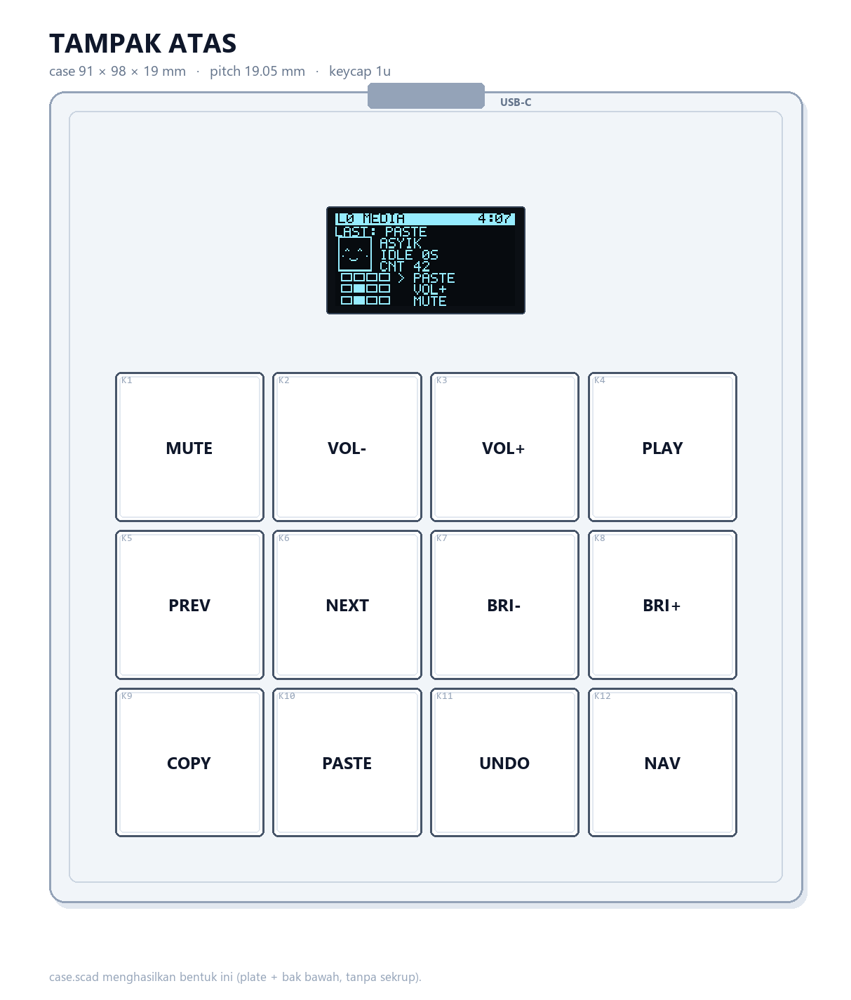
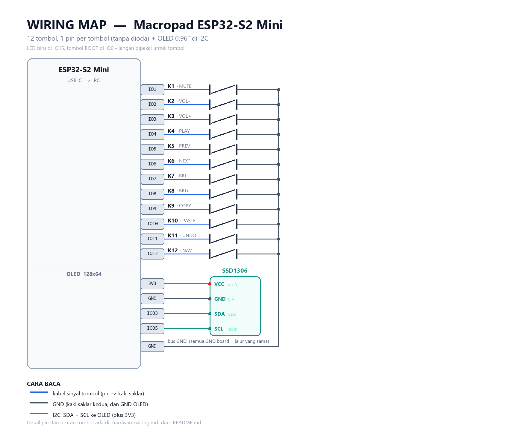
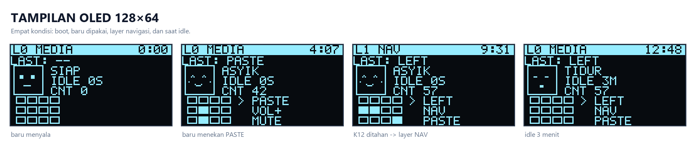

# Macropad ESP32 — 12 tombol + OLED

Macropad meja kerja dengan **12 tombol mekanikal** dan **OLED 0.96"** yang jadi panel status
sekaligus "companion" kecil: menampilkan layer aktif, tombol terakhir, peta 12 tombol yang
menyala saat ditekan, dan wajah yang berkedip / senang saat kamu mengetik / tidur saat kamu
tinggalkan.

Jalan di **ESP32-S2 Mini, LOLIN S3 Mini, dan ESP32-S3 Super Mini** — pilih board lewat satu
baris di `firmware/kb.py`. Semua lewat USB HID bawaan ESP32 — **tanpa driver, tanpa software
tambahan** di komputer, dan **tanpa library tambahan** di board (cukup CircuitPython + KMK).



| | |
|---|---|
| **Board** | ESP32-S2 Mini · LOLIN S3 Mini · ESP32-S3 Super Mini |
| **Tombol** | 12 × switch — **MX** atau **tactile 6×6**, pilih salah satu |
| **Layar** | OLED 0.96" SSD1306 128×64, I2C |
| **Layer** | 2 (media + navigasi) |
| **Firmware** | CircuitPython + [KMK](https://github.com/KMKfw/kmk_firmware) + driver OLED sendiri |
| **Ukuran case** | MX: 91 × 98 × 19 mm · tactile: **75 × 86 × 11 mm** |
| **Koneksi** | USB-C (kabel data) |

### Papan yang didukung

| Board | Chip | CircuitPython (board id) | I2C | BLE | Catatan |
|---|---|---|---|---|---|
| **ESP32-S2 Mini** | ESP32-S2FN4R2 | `lolin_s2_mini` | SDA `IO33`, SCL `IO35` | ✗ | default, paling matang |
| **LOLIN S3 Mini** | ESP32-S3FH4R2 | `lolin_s3_mini` | SDA `IO35`, SCL `IO36` | ✓ | 27 IO, ukuran sama dengan S2 Mini |
| **ESP32-S3 Super Mini** | ESP32-S3FH4R2 | `generic_esp32s3_supermini` | SDA `IO33`, SCL `IO34` | ✓ | 23,5 × 18 mm, 35 GPIO |

Cara memilih board (di `firmware/kb.py`):

```python
BOARD = "s2"            # "s2" | "s3_mini" | "s3_supermini"
```

Atau tanpa mengedit file — buat `settings.toml` di `CIRCUITPY`:

```toml
MACROPAD_BOARD = "s3_mini"
```

> **Catatan S3:** kedua board S3 punya **Bluetooth LE**, jadi sebenarnya bisa dibuat
> nirkabel. Itu butuh library `adafruit_ble` (bundle Adafruit) dan `HIDModes.BLE` di KMK —
> belum diaktifkan di repo ini karena menambah dependensi. Versi default tetap USB.
>
> **Catatan S3 Super Mini:** CircuitPython untuk board ini baru tersedia di channel
> **11.0.0-alpha** (belum ada rilis stabil). Kalau butuh yang stabil, pakai S2 atau S3 Mini.

---

## Isi repo

| File | Isi |
|---|---|
| `firmware/kb.py` | pilih board + peta pin → tombol dan pin I2C OLED |
| `firmware/profiles.py` | tabel pin ketiga board (dipakai juga oleh generator gambar) |
| `firmware/code.py` | keymap, layer, label layar, inisialisasi OLED |
| `firmware/ui.py` | isi layar: header, wajah companion, peta tombol, log |
| `firmware/ssd1306.py` | driver OLED (I2C, framebuffer, teks) — tanpa library luar |
| `firmware/font5x7.py` | font bitmap 5×7 (dibuat oleh `tools/gen_font.py`) |
| `firmware/bringup.py` | tes hardware: tombol, I2C, OLED, dan tes ketik |
| `hardware/wiring_s2.png` | peta kabel ESP32-S2 Mini |
| `hardware/wiring_s3_mini.png` | peta kabel LOLIN S3 Mini |
| `hardware/wiring_s3_supermini.png` | peta kabel ESP32-S3 Super Mini |
| `hardware/wiring.md` | tabel pin ketiga board + catatan OLED |
| `hardware/oled_states.png` | tampilan layar di 4 kondisi |
| `hardware/layout.png` | gambar tampak atas |
| `hardware/plate_mx_1to1.pdf` | template plate skala **1:1** versi MX |
| `hardware/plate_tactile_1to1.pdf` | template plate skala **1:1** versi tactile |
| `hardware/case_mx.scad` | case 3D versi MX (lubang 14 mm, tinggi 19 mm) |
| `hardware/case_tactile.scad` | case 3D versi tactile (lubang 7 mm, tinggi 11 mm) |
| `hardware/bom.csv` | daftar belanja |
| `tools/deploy.ps1` | copy firmware + KMK ke board, sekali perintah |
| `tools/push_to_github.ps1` | buat repo GitHub + push, sekali perintah |
| `tools/make_diagrams.py` | generator ulang semua gambar |
| `tools/gen_font.py` | generator font bitmap OLED |

---

## Baca dulu: 5 batasan penting

1. **Bluetooth hanya di versi S3.** ESP32-S2 Mini cuma WiFi; LOLIN S3 Mini dan S3 Super Mini
   punya BLE 5.0 (belum diaktifkan di firmware ini — lihat catatan di atas).
2. **Satu port USB-C untuk semuanya**: flashing, console/REPL, dan HID. Itu justru enak —
   satu kabel, dan tidak ada driver CH340 yang perlu diinstal.
3. **Pin yang jangan disentuh** (berlaku umum): `IO0` (tombol BOOT), `IO19`/`IO20` (USB),
   `IO26`–`IO32` (flash/PSRAM internal). Di S2 Mini tambahan: `IO15` (LED biru).
   Tabel pin lengkap per board ada di [`hardware/wiring.md`](hardware/wiring.md).
4. **Tombol kecerahan (`BRI+` / `BRI-`) hanya jalan di macOS.** Di Windows umumnya
   tidak berefek — ganti dengan hotkey lain (lihat bagian *Kustomisasi*).
5. **OLED itu opsional.** Kalau belum punya layarnya, set `USE_OLED = False` di `kb.py` —
   macropad tetap jalan penuh sebagai keyboard.

> **Board lama:** pada S2 Mini v1.0.0 produksi sebelum akhir 2021, label `IO12` dan `IO13`
> di silkscreen **tertukar**. Gejalanya cuma satu: tombol K12 (kanan bawah) tidak terbaca.
> Perbaikannya satu baris di `firmware/profiles.py` (lihat *Troubleshooting*).

---

## Belanja

Tabel lengkap ada di [`hardware/bom.csv`](hardware/bom.csv). Ringkasnya:

| Komponen | Jumlah | Perkiraan harga |
|---|---|---|
| **Board — pilih salah satu** | 1 | |
| ↳ ESP32-S2 Mini | | Rp 50.000 – 75.000 |
| ↳ LOLIN S3 Mini | | Rp 90.000 – 130.000 |
| ↳ ESP32-S3 Super Mini | | Rp 60.000 – 90.000 |
| OLED 0.96" SSD1306 I2C | 1 | Rp 25.000 – 40.000 |
| **Switch — pilih salah satu** | | |
| ↳ MX (red/brown/blue) | 12 | Rp 70.000 – 120.000 |
| ↳ tactile 6×6 (idealnya 6×6×9,5) | 12 | Rp 15.000 – 25.000 |
| Keycap 1u (hanya versi MX) | 12 | Rp 40.000 – 100.000 (bisa dari keyboard bekas) |
| Tutup bulat 6–7 mm (opsional, tactile) | 12 | Rp 12.000 – 24.000 |
| PCB bolong / pelat lubang 5×7 cm | 1 | Rp 5.000 – 10.000 |
| Kawat silikon 26–28 AWG (atau kabel pita) | secukupnya | Rp 15.000 |
| Header female 1×15 (opsional, biar board bisa dilepas) | 2 | Rp 5.000 |
| Timah + flux, heat shrink, double tape | — | — |

**Punya:** solder, multimeter, tang potong.
**Butuh akses:** printer 3D untuk case (atau pakai akrilik/kardus dulu — case bukan
bagian yang bikin macropad ini jalan).

Kalau ingin versi tanpa solder sama sekali: 12 tombol tactile 6 mm di breadboard + kabel
jumper, OLED disambung dengan 4 jumper female-female. Semua kode di repo ini tetap sama.

**Beli OLED yang benar:** cari modul **0.96 inch, SSD1306, 4 pin, I2C**. Yang 7 pin
(SPI) atau 1.3" (SH1106) tidak akan jalan dengan driver di repo ini tanpa penyesuaian.

---

## Dua versi: MX atau tactile

Isi repo ini menyediakan **dua versi mekanik**. Firmware, wiring, dan keymap **sama
persis** untuk keduanya — yang berbeda hanya bagian cetak/cetakan.

| | **MX** | **Tactile 6×6** |
|---|---|---|
| Switch | MX red/brown/blue (14 mm) | tactile 6×6 mm |
| Jarak antar tombol | 19,05 mm | 15 mm |
| Ukuran case | 91 × 98 × 19 mm | **75 × 86 × 11 mm** |
| Lubang plate | 14 × 14 mm | 7 mm bulat |
| Harga 12 switch | Rp 70–120 rb | **Rp 15–25 rb** |
| Keycap | wajib 1u | tidak wajib (tutup bulat opsional) |
| Perasaan mengetik | perjalanan panjang, pegas | klik pendek, tegas |
| Case | `hardware/case_mx.scad` | `hardware/case_tactile.scad` |
| Template 1:1 | `hardware/plate_mx_1to1.pdf` | `hardware/plate_tactile_1to1.pdf` |

**Pilih MX kalau** kamu mau terasa seperti keyboard sungguhan, punya keycap, dan tidak
masalah dengan biaya/tinggi case.

**Pilih tactile kalau** kamu mau murah, tipis (11 mm), cepat dibangun, dan tidak butuh
keycap. Ini juga pilihan terbaik untuk percobaan pertama.

### Kalau memilih tactile: 3 hal penting

1. **Jangan pakai dua kaki yang sebelah.** Kaki di sisi yang sama sudah tersambung di
   dalam — kalau disolder keduanya, tombol short permanen. Pakai satu kaki kiri + satu
   kanan (1-3, 1-4, 2-3, atau 2-4). Cek dengan multimeter: yang berbunyi **tanpa** ditekan
   adalah pasangan yang salah.
2. **Tanpa header female.** Tinggi dalam case tactile hanya ~6 mm. Solder kabel langsung
   ke pad board (atau pakai header rendah). Versi MX punya ruang 14 mm kalau mau header.
3. **Pakai tact 6×6×9,5** (actuator panjang) supaya tombol menonjol ~2 mm dari plate.
   Yang 6×6×5 terlalu tenggelam.

> Kedua case sama-sama **belum diuji cetak**. Cetak plate dulu, coba pasang 1 switch,
> baru cetak tray-nya.

---

## Langkah 1 — Pasang CircuitPython

Board dari pabrik biasanya berisi MicroPython. Kita ganti ke CircuitPython.

1. Unduh firmware sesuai board-mu, ambil tombol *DOWNLOAD .UF2 NOW*:
   - ESP32-S2 Mini → <https://circuitpython.org/board/lolin_s2_mini/>
   - LOLIN S3 Mini → <https://circuitpython.org/board/lolin_s3_mini/>
   - S3 Super Mini → <https://circuitpython.org/board/generic_esp32s3_supermini/>
2. Masuk mode bootloader: tekan **RESET** sekali, tunggu sampai LED menyala, lalu
   **tahan BOOT**. (Jangan menahan BOOT saat RESET ditekan — urutannya RESET dulu, BOOT
   belakangan.) Muncul drive baru bernama `BOOT` (atau `FTHRS2BOOT`).
3. Copy file `.uf2` ke drive itu. Board restart sendiri, muncul drive **`CIRCUITPY`**.
4. Cek `boot_out.txt` di dalam `CIRCUITPY` — di situ tertulis versi CircuitPython dan
   versi TinyUF2.

> **Kalau setelah copy UF2 tidak muncul `CIRCUITPY`:** TinyUF2 di board terlalu tua untuk
> CircuitPython 10 (butuh ≥ 0.33.0). Dua pilihan: (a) pasang TinyUF2 0.35.0 untuk board-mu
> (link "DOWNLOAD BOOTLOADER" ada di halaman CircuitPython board tersebut) lewat ROM
> bootloader, atau (b) pakai CircuitPython 9.x dari halaman *Previous Versions*.
> Cara (b) lebih cepat kalau kamu tidak mau menyentuh bootloader.

> **LED menyala terus / tidak ada drive sama sekali?** Coba kabel USB lain —
> banyak kabel murah hanya untuk daya. Board ini butuh kabel data.

---

## Langkah 2 — Pasang KMK + firmware

KMK **tidak butuh library tambahan** (tidak perlu `adafruit_hid`, `adafruit_ssd1306`,
atau bundle Adafruit). Driver OLED-nya ada di repo ini.

### Cara otomatis (Windows)

```powershell
# dari folder repo ini
powershell -ExecutionPolicy Bypass -File tools\deploy.ps1
```

Script akan mencari drive `CIRCUITPY`, mengunduh KMK kalau belum ada, lalu menyalin
**semua** file di `firmware/` (`code.py`, `kb.py`, `profiles.py`, `ui.py`, `ssd1306.py`,
`font5x7.py`). Untuk mode tes hardware: tambahkan `-Bringup`.

> **Pilih board dulu** sebelum menyalin: `BOARD = "s2"` / `"s3_mini"` / `"s3_supermini"`
> di `firmware/kb.py` (atau lewat `settings.toml`). Kalau salah, tombol tidak akan terbaca
> karena pin-nya berbeda.

### Cara manual

1. Unduh <https://github.com/KMKfw/kmk_firmware/archive/refs/heads/main.zip>, ekstrak.
2. Copy folder **`kmk_firmware-main/kmk`** ke root `CIRCUITPY` (jadi `CIRCUITPY/kmk/...`).
3. Copy **semua** file `.py` dari `firmware/` (kecuali `bringup.py`) ke root `CIRCUITPY`.
4. Tunggu 2 detik, board restart sendiri. Layar menyala, coba tekan K1 (harusnya mute).

Struktur akhir drive:

```
CIRCUITPY/
├─ code.py
├─ kb.py
├─ profiles.py
├─ ui.py
├─ ssd1306.py
├─ font5x7.py
└─ kmk/
   ├─ kmk_keyboard.py
   ├─ keys.py
   └─ ...
```

### Melihat output / REPL

- **Paling mudah:** buka <https://code.circuitpython.org> di Chrome/Edge, klik *Connect*,
  pilih board. Semua `print()` dan error muncul di situ.
- Alternatif: PuTTY ke port COM board (baud apa saja untuk USB CDC).

Saat start, `code.py` mencetak salah satu dari:

```
OLED OK di alamat 0x3c
OLED tidak terdeteksi. Alamat I2C yang menjawab: []
OLED gagal dipakai: ...
```

Kalau bukan `OLED OK`, layar tidak akan menyala tapi keyboard tetap jalan.

---

## Langkah 3 — Tes hardware dulu (`bringup.py`)

Jangan langsung keymap. Tes dulu, supaya kalau ada yang salah kita tahu itu kabel
atau software.

```powershell
powershell -ExecutionPolicy Bypass -File tools\deploy.ps1 -Bringup
```

Yang terjadi:
1. **Scan I2C** — daftar alamat yang menjawab dicetak (`['0x3c']` kalau OLED terpasang).
2. **Tes layar** — OLED menampilkan `OLED OK` / `TES LAYAR`.
3. **Tes HID** — setelah hitung mundur 3 detik, board mengetik `hai` ke komputer.
4. **Tes tombol** — setiap tombol yang kamu tekan dicetak namanya (`K1`, `K7`, …).

Urutannya: sambungkan satu tombol, tekan, lihat nama yang muncul. Kalau muncul nama yang
salah, tinggal tukar urutan di `KEY_PINS` — tidak perlu solder ulang.

Kalau semua sudah benar, kembali ke mode normal:

```powershell
powershell -ExecutionPolicy Bypass -File tools\deploy.ps1
```

---

## Langkah 4 — Wiring



Gambar di atas versi **ESP32-S2 Mini**. Untuk S3 Mini dan Super Mini lihat
[`hardware/wiring.md`](hardware/wiring.md) — pin-nya berbeda, terutama I2C.

Detail pin ada di [`hardware/wiring.md`](hardware/wiring.md). Intinya:

- Setiap tombol: **satu kaki → pin GPIO**, **kaki lain → GND**. Tidak ada resistor,
  tidak ada dioda, tidak ada 3V3.
- OLED: `VCC → 3V3`, `GND → GND`, `SDA`/`SCL` sesuai board (S2: `IO33`/`IO35`,
  S3 Mini: `IO35`/`IO36`, Super Mini: `IO33`/`IO34`).
  **Ikuti label di PCB modul** — urutan pin antar modul bisa berbeda, dan jangan beri 5V.
- **Cek modul OLED dulu** (tanpa tombol) dengan `-Bringup`: kalau `I2C scan` kosong,
  jangan lanjut solder 12 tombol.

Urutan kerja yang saya sarankan:

1. Solder header female ke board (opsional tapi memudahkan servis).
2. Sambung OLED dulu: 4 kabel, tes dengan `-Bringup`. Begitu layar menyala, sisanya
   jauh lebih mudah karena kamu punya alat diagnosa sendiri di tangan.
3. Tempel board ke pelat/PCB bolong dengan double tape.
4. Pasang 12 switch: MX dikunci ke plate, tactile disolder ke PCB (plate hanya menutup).
5. Sambung **GND** dulu ke semua kaki kedua switch — satu jalur, boleh berantai.
6. Sambung pin sinyal satu per satu, sambil **tes tiap tombol** dengan `bringup.py`.

Tips: pakai kawat warna berbeda untuk GND (hitam) dan sinyal, dan beri sedikit lem
panas di pangkal kabel supaya tidak mencabut pad saat kabel tertarik. Board ini tidak
punya lubang mounting — double tape busa adalah cara paling aman.

---

## Langkah 5 — Case (opsional)

Pilih dulu versinya (lihat *Dua versi: MX atau tactile*). Dua cara:

**A. Tanpa printer 3D** — cetak template yang sesuai di kertas **100% / actual size**
(bukan *fit to page*; ada garis kalibrasi 50 mm untuk memastikan):

- versi MX → `hardware/plate_mx_1to1.pdf`
- versi tactile → `hardware/plate_tactile_1to1.pdf`

Tempel ke akrilik/kayu/kardus tebal, bor titik tengah tiap lubang, potong dengan gergaji
ukir. Plate ini yang menahan switch (MX) atau menutup tombol (tactile), sekaligus tempat
menempel OLED.

**B. Printer 3D** — buka file SCAD yang sesuai di OpenSCAD, set `PART = "plate"`, render,
export STL, cetak. Ulangi dengan `PART = "tray"`. Cetak plate dulu (kira-kira 1 jam), coba
masukkan satu switch; kalau terlalu ketat/longgar, ubah `key_hole` (MX 14.05 → 13.95/14.15,
tactile 7.0 → 6.8/7.2).

Plate duduk di bibir di dalam bak dan ditahan oleh tekanan tombol — tidak ada sekrup.
Kalau longgar, dua tetes lem panas di sudut sudah cukup. Celah USB-C ada di dinding depan.

**Memasang OLED:** tempel modul (27,3 × 27,3 mm) di **bawah** plate dengan double tape,
kaca menghadap jendela 24 × 13 mm. Jendela sengaja lebih kecil dari kaca, jadi modul
tidak bisa jatuh menembus. Pasang sebelum menyolder kabel supaya posisinya pas.

> Case ini titik awal, bukan desain final. Untuk hasil rapi, biasanya orang mengiterasi
> 1–2 kali cetak (toleransi printer berbeda-beda).

---

## Keymap

```
layer 0 (default)                      layer 1 (tahan K12)
┌────────┬────────┬────────┬────────┐  ┌────────┬────────┬────────┬────────┐
│  MUTE  │  VOL-  │  VOL+  │  PLAY  │  │   ·    │  HOME  │   ↑    │  END   │
├────────┼────────┼────────┼────────┤  ├────────┼────────┼────────┼────────┤
│  PREV  │  NEXT  │  BRI-  │  BRI+  │  │   ·    │   ←    │   ↓    │   →    │
├────────┼────────┼────────┼────────┤  ├────────┼────────┼────────┼────────┤
│ Ctrl+C │ Ctrl+V │ Ctrl+Z │  NAV   │  │ PGUP   │ PGDN   │  DEL   │   ·    │
└────────┴────────┴────────┴────────┘  └────────┴────────┴────────┴────────┘
```

`·` = tembus ke layer di bawahnya (`KC.TRNS`), jadi tombol tetap berfungsi seperti biasa.
K12 di layer 1 dibiarkan `·` karena selama ditahan posisinya sudah dipakai `KC.MO(1)`.

---

## Layar: apa yang ditampilkan



| Bagian | Isi |
|---|---|
| bar atas (putih) | `L0 MEDIA` / `L1 NAV` + waktu sejak board menyala |
| baris `LAST` | tombol terakhir yang ditekan |
| kiri | wajah companion (lihat tabel di bawah) |
| kanan | mood (`SIAP` / `ASYIK` / `TIDUR`), lama idle, jumlah tekanan |
| bawah kiri | peta 4×3 tombol; kotak terisi = tombol sedang ditekan |
| bawah kanan | 3 tombol terakhir |

Wajah companion:

| Kondisi | Wajah |
|---|---|
| baru menyala / diam | netral, berkedip tiap ~4 detik |
| dalam 0,9 detik setelah menekan tombol | senang (mata `^ ^`, pipi) |
| tidak disentuh lebih dari 60 detik | tidur (mata tertutup, mulut kecil) |

Ukuran dan isi layar ada di `firmware/ui.py`. Yang biasanya ingin diubah:

```python
IDLE_HAPPY_MS = 900       # berapa lama wajah senang setelah menekan tombol
IDLE_SLEEP_MS = 60000     # setelah ini companion tidur
MOOD_WORDS = ('SIAP', 'ASYIK', 'TIDUR')
```

Label tombol yang tampil **tidak** diambil otomatis dari keymap — ada di `LABELS`
(`firmware/code.py`). Kalau kamu mengubah keymap, ubah labelnya juga supaya layar tidak
berbohong. Huruf yang tersedia hanya **A–Z, 0–9 dan sedikit simbol** (font 5×7 di
`font5x7.py`); huruf kecil akan tampil sebagai `?`.

Kecerahan layar bisa diatur di `code.py` → `SSD1306(i2c, addr, contrast=0xCF)`
(nilai 0x00–0xFF).

---

## Kustomisasi

Semua ada di `firmware/code.py`, dan setiap perubahan langsung aktif setelah disimpan
(board restart otomatis). Referensi keycode lengkap:
<https://github.com/KMKfw/kmk_firmware/blob/main/docs/en/keycodes.md>

**Ganti satu tombol** — cukup ganti satu baris di `keyboard.keymap`:

```python
KC.LCTRL(KC.S),        # ganti dari Ctrl+C ke Ctrl+S
```

**Tombol multimedia lain** yang sudah tersedia: `KC.MNXT`, `KC.MPRV`, `KC.MPLY`,
`KC.MSTP`, `KC.MUTE`, `KC.VOLU`, `KC.VOLD`, `KC.BRIU`, `KC.BRID`, `KC.EJCT`.

**Tambah layer 2 (misalnya numpad):** tambahkan satu list lagi di `keyboard.keymap`,
tambahkan barisnya di `LABELS`, dan ganti `KC.MO(1)` menjadi `KC.MO(2)`.

**Tombol "sekali tekan jadi 2 tombol"** (mis. `Ctrl+Shift+T`):

```python
KC.LCTRL(KC.LSFT(KC.T))
```

**Ganti jumlah tombol:** hapus entry di `KEY_PINS`, di setiap layer keymap, dan di
`LABELS` — ketiganya harus tetap sepanjang yang sama.

---

## Troubleshooting

| Gejala | Penyebab / solusi |
|---|---|
| Tidak ada drive `CIRCUITPY` | Kabel *charge-only*, atau TinyUF2 terlalu tua → lihat Langkah 1 |
| Board restart terus, REPL menampilkan error | Ada typo di `code.py`; baca pesan error di REPL |
| Semua tombol mati | `kmk` tidak ada di root `CIRCUITPY`, atau `code.py` tidak ter-copy |
| Semua tombol mati **setelah ganti board** | `BOARD` di `kb.py` masih `"s2"` padahal boardnya S3 (atau sebaliknya). REPL akan bilang pin tidak ada |
| Satu tombol tidak terbaca | Kabel putus / salah pin. Cek dengan `bringup.py` |
| Tombol terbaca tapi nama tertukar | Tukar urutan di `keys` pada `firmware/profiles.py` |
| K12 mati, sisanya normal (S2 Mini) | Silkscreen lama: ganti `'IO12'` → `'IO13'` di `profiles.py` (board `s2`) |
| Layar gelap di S3 Mini | I2C S3 Mini di `IO35`/`IO36`, bukan `IO33`/`IO35` seperti S2 |
| Semua tombol terbalik (selalu "ditekan") | Kaki switch tersambung ke 3V3, bukan GND. Pindahkan ke GND |
| **Layar gelap, tombol tetap jalan** | `code.py` mencetak `OLED tidak terdeteksi` → cek SDA/SCL tertukar, VCC belum dapat 3V3, atau alamat bukan 0x3C |
| Layar menyala tapi isinya terbalik/geser | Modul memakai driver SH1106 (1.3"), bukan SSD1306. Ganti modul atau sesuaikan driver |
| Tulisan di layar jadi `?` | Huruf kecil / karakter di luar font 5×7. Pakai huruf besar |
| Layar berkedip atau macet | Kabel I2C terlalu panjang / tidak ada pull-up. Pendekkan kabel (< 20 cm) |
| Tombol kecerahan tidak berefek | Normal di Windows; ganti keycode-nya |
| Port USB tidak dikenali setelah dipakai | Tekan RESET; kalau perlu masuk bootloader dan flash ulang |

---

## Ide lanjutan

- **RGB LED** per tombol (WS2812) — butuh 1 pin data dan `kmk/extensions/rgb.py`.
- **Tombol kombinasi** (combos) atau **hold-tap** — modul `combos` dan `holdtap` di KMK.
- **Layar lebih besar**: modul 1.3" (SH1106) atau OLED 128×32 — driver di repo ini tinggal
  disesuaikan (SH1106 butuh offset kolom 2 piksel).
- **Animasi wajah** saat idle (misal mata melihat ke arah tombol yang ditekan).
- **Layout lain**: 4×4, 5×3, atau tambah layer numpad penuh.

---

## Referensi

- CircuitPython:
  [S2 Mini](https://circuitpython.org/board/lolin_s2_mini/) ·
  [LOLIN S3 Mini](https://circuitpython.org/board/lolin_s3_mini/) ·
  [S3 Super Mini](https://circuitpython.org/board/generic_esp32s3_supermini/)
- KMK firmware: <https://github.com/KMKfw/kmk_firmware> · dokumentasi:
  <https://github.com/KMKfw/kmk_firmware/tree/main/docs/en>
- Pinout & skema S2 Mini: <https://www.wemos.cc/en/latest/s2/s2_mini.html>
- Pinout S3 Super Mini (35 GPIO): <https://www.espboards.dev/esp32/esp32-s3-super-mini/>
- Datasheet SSD1306: <https://cdn-shop.adafruit.com/datasheets/SSD1306.pdf>
- Editor + REPL berbasis browser: <https://code.circuitpython.org>

## Lisensi

MIT — lihat [`LICENSE`](LICENSE). Bebas dipakai, dimodifikasi, dan dijual lagi;
cukup sertakan notice hak cipta.

Kalau ada bagian yang membingungkan, itu tanda dokumentasinya yang harus diperbaiki —
bukan kamu.
