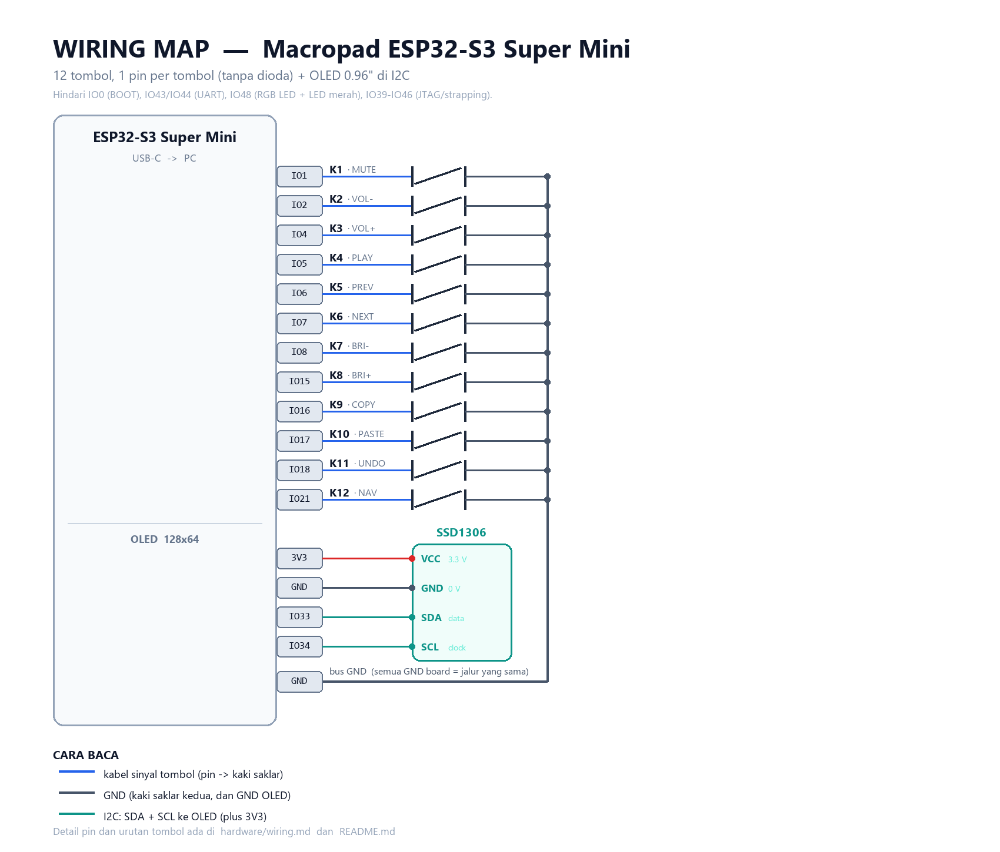

# Peta kabel (wiring)

Firmware dan wiring **sama untuk ketiga board** — yang berbeda hanya nomor pin.
Pilih board-mu di `firmware/kb.py` (`BOARD = "s2" | "s3_mini" | "s3_supermini"`).

Semua tombol disambung **satu pin per tombol** — tidak ada dioda, tidak ada baris/kolom.
Satu kaki saklar ke pin GPIO, kaki lainnya ke **GND**. Pull-up sudah ada di dalam ESP32,
jadi tidak perlu resistor. OLED memakai **I2C** (2 kabel sinyal + daya).

## Pin per board

| Tombol | S2 Mini | S3 Mini | S3 Super Mini | Fungsi (layer 0) |
|--------|---------|---------|---------------|------------------|
| K1  | `IO1`  | `IO1`  | `IO1`  | Mute |
| K2  | `IO2`  | `IO2`  | `IO2`  | Volume turun |
| K3  | `IO3`  | `IO3`  | `IO4`  | Volume naik |
| K4  | `IO4`  | `IO4`  | `IO5`  | Play / pause |
| K5  | `IO5`  | `IO5`  | `IO6`  | Trek sebelumnya |
| K6  | `IO6`  | `IO6`  | `IO7`  | Trek berikutnya |
| K7  | `IO7`  | `IO7`  | `IO8`  | Kecerahan turun |
| K8  | `IO8`  | `IO8`  | `IO15` | Kecerahan naik |
| K9  | `IO9`  | `IO9`  | `IO16` | Ctrl+C (copy) |
| K10 | `IO10` | `IO10` | `IO17` | Ctrl+V (paste) |
| K11 | `IO11` | `IO11` | `IO18` | Ctrl+Z (undo) |
| K12 | `IO12` | `IO12` | `IO21` | tahan = layer navigasi |
| OLED SDA | `IO33` | `IO35` | `IO33` | data I2C |
| OLED SCL | `IO35` | `IO36` | `IO34` | clock I2C |
| OLED VCC | `3V3`  | `3V3`  | `3V3`  | **jangan 5V** |
| OLED GND | `GND`  | `GND`  | `GND`  | — |

> **Kenapa S3 Super Mini melompat-lompat?** Board itu mengekspos 35 GPIO, tapi sebagian
> terpakai untuk strapping/JTAG/UART/RGB LED. Yang dipakai di sini hanya pin "aman":
> `IO1`, `IO2`, `IO4`–`IO8`, `IO15`–`IO18`, `IO21`. Hindari `IO0` (BOOT),
> `IO43`/`IO44` (UART), `IO48` (RGB LED + LED merah), dan `IO39`–`IO46` (JTAG/strapping).

## Gambar per board

### ESP32-S2 Mini


### LOLIN S3 Mini


### ESP32-S3 Super Mini


## OLED 0.96" (SSD1306, 128x64, I2C)

| Pin modul | Fungsi | Pin board |
|-----------|--------|-----------|
| VCC | daya 3.3 V | `3V3` |
| GND | ground | `GND` |
| SDA | data I2C | lihat tabel di atas |
| SCL | clock I2C | lihat tabel di atas |

**Jangan beri 5V ke VCC.** Modul SSD1306 biasanya punya regulator + level shifter dan
tahan 5V, tapi versi murah tidak — 3V3 selalu aman.

### Urutan pin modul bisa berbeda

Modul 0.96" yang dijual bebas punya dua urutan pin yang umum:

```
   GND  VCC  SCL  SDA        atau        VCC  GND  SCL  SDA
```

**Ikuti label yang tercetak di PCB modul**, bukan urutan di gambar. Kalau tidak ada label,
cari pin GND dengan multimeter (mode continuity ke jalur ground) sebelum menyolder.

### Cek sebelum dipakai

1. Pasang OLED saja (tanpa 12 tombol dulu), lalu jalankan `tools\deploy.ps1 -Bringup`.
2. Di REPL akan muncul `I2C scan : ['0x3c']`. Kalau kosong → kabel/alamat salah.
3. Layar harus menampilkan `OLED OK` / `TES LAYAR`.

Alamat I2C paling umum `0x3C`. Kalau modulmu `0x3D`, firmware otomatis mencoba alamat itu
(lihat `firmware/code.py`).

## Hal yang perlu diperhatikan

- Kabel: pakai kawat silikon 26–28 AWG atau kabel pita. Kabel I2C sebaiknya pendek
  (< 20 cm). Pisahkan jalur sinyal dari kabel USB kalau memungkinkan.
- Beri **strain relief**: rekatkan board ke dasar case dengan double tape, dan ikat/lem
  kabel di dekat header supaya tidak mencabut pad.
- Semua pin `GND` di board adalah jalur yang sama — bebas pakai yang mana pun.
  Gambar di atas menggambar beberapa pad GND terpisah hanya agar mudah dibaca.
- Tidak ada koneksi **3V3** ke tombol. 3V3 hanya untuk OLED.
- **Silkscreen S2 Mini lama:** pada v1.0.0 produksi sebelum akhir 2021, label `IO12` dan
  `IO13` **tertukar**. Gejalanya: semua tombol jalan kecuali K12. Solusi satu baris di
  `firmware/profiles.py`: ganti `'IO12'` menjadi `'IO13'` pada daftar `keys` board `s2`.
- **S3 Super Mini** Letakkan antena keramik menghadap ke luar case (jangan tertutup
  pelat logam/foil) kalau nanti mau dipakai untuk BLE.

## Urutan tombol yang dipakai firmware

`firmware/kb.py` membaca tombol berurutan: kiri→kanan, baris atas, tengah, bawah.
Jadi `KEY_PINS[0]` = K1, `KEY_PINS[3]` = K4, `KEY_PINS[4]` = K5, dan seterusnya.
Kalau kabel tertukar, cukup tukar urutan di `firmware/profiles.py` — tidak perlu solder ulang.
