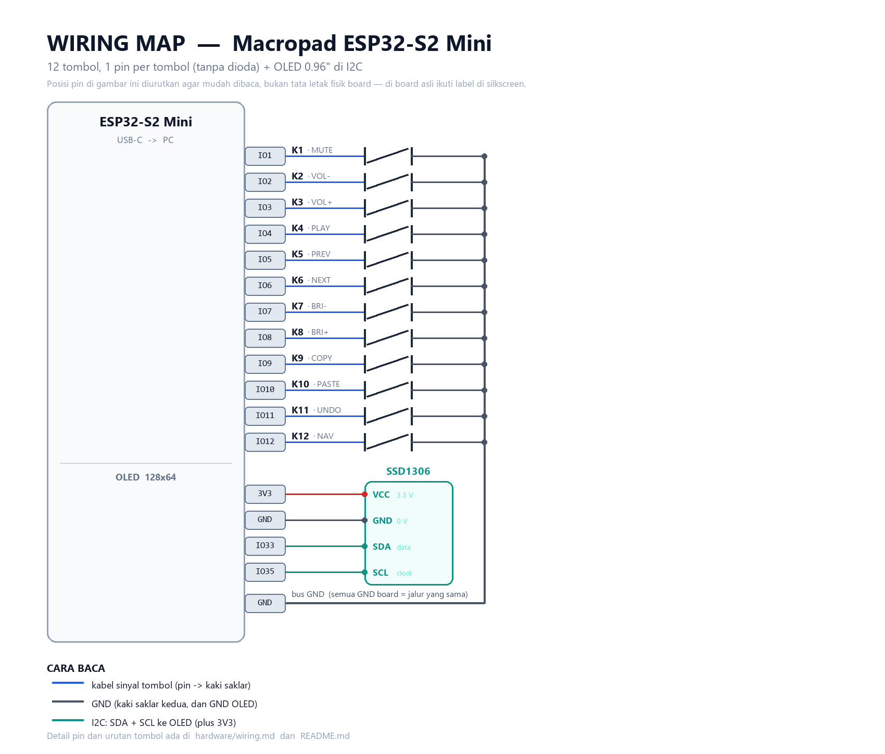

# Peta kabel (wiring)



Semua tombol disambung **satu pin per tombol** — tidak ada dioda, tidak ada baris/kolom.
Satu kaki saklar ke pin GPIO, kaki lainnya ke **GND**. Pull-up sudah ada di dalam ESP32-S2,
jadi tidak perlu resistor.

OLED memakai **I2C** (2 kabel sinyal + daya), di pin I2C bawaan board. Jadi total hanya
2 pin tambahan di luar 12 pin tombol.

## 12 tombol

| Tombol | Posisi | Pin board | Fungsi default (layer 0) | Fungsi layer 1 (tahan K12) |
|--------|--------|-----------|--------------------------|----------------------------|
| K1  | baris 1, kolom 1 | `IO1`  | Mute | (tembus) |
| K2  | baris 1, kolom 2 | `IO2`  | Volume turun | Home |
| K3  | baris 1, kolom 3 | `IO3`  | Volume naik | Panah atas |
| K4  | baris 1, kolom 4 | `IO4`  | Play / pause | End |
| K5  | baris 2, kolom 1 | `IO5`  | Trek sebelumnya | (tembus) |
| K6  | baris 2, kolom 2 | `IO6`  | Trek berikutnya | Panah kiri |
| K7  | baris 2, kolom 3 | `IO7`  | Kecerahan turun | Panah bawah |
| K8  | baris 2, kolom 4 | `IO8`  | Kecerahan naik | Panah kanan |
| K9  | baris 3, kolom 1 | `IO9`  | Ctrl+C (copy) | Page Up |
| K10 | baris 3, kolom 2 | `IO10` | Ctrl+V (paste) | Page Down |
| K11 | baris 3, kolom 3 | `IO11` | Ctrl+Z (undo) | Delete |
| K12 | baris 3, kolom 4 | `IO12` | **tahan** = layer navigasi | (tembus) |

## OLED 0.96" (SSD1306, 128x64, I2C)

| Pin modul | Fungsi | Pin board |
|-----------|--------|-----------|
| VCC | daya 3.3 V | `3V3` |
| GND | ground | `GND` |
| SDA | data I2C | `IO33` |
| SCL | clock I2C | `IO35` |

**Jangan beri 5V ke VCC.** Modul SSD1306 biasanya punya regulator + level shifter dan
tahan 5V, tapi versi murah tidak — 3V3 selalu aman.

### Urutan pin modul bisa berbeda

Modul 0.96" yang dijual bebas punya dua urutan pin yang umum:

```
   GND  VCC  SCL  SDA        atau        VCC  GND  SCL  SDA
```

**Ikuti label yang tercetak di PCB modul**, bukan urutan di gambar ini. Kalau tidak ada
label, cari pin GND dengan multimeter (mode continuity ke jalur ground) sebelum menyolder.

### Cek sebelum dipakai

1. Pasang OLED saja (tanpa 12 tombol dulu), lalu jalankan `tools\deploy.ps1 -Bringup`.
2. Di REPL akan muncul `I2C scan : ['0x3c']`. Kalau kosong → kabel/alamat salah.
3. Layar harus menampilkan `OLED OK` / `TES LAYAR`.

Alamat I2C paling umum `0x3C`. Kalau modulmu `0x3D`, firmware otomatis mencoba alamat itu
(lihat `firmware/code.py`).

## Hal yang perlu diperhatikan

- **Jangan pakai** `IO0` (tombol BOOT), `IO15` (LED biru bawaan), `IO19`/`IO20` (USB),
  dan `IO26`–`IO32` (flash/PSRAM internal). Pin itu tidak tersedia untuk tombol.
  `IO33`/`IO35` dipakai OLED, jadi jangan dipakai untuk tombol.
- **Silkscreen lama:** pada board v1.0.0 produksi sebelum akhir 2021, label `IO12` dan
  `IO13` di board **tertukar**. Gejalanya: semua tombol jalan kecuali K12. Solusinya
  satu baris di `firmware/kb.py`: ganti `board.IO12` menjadi `board.IO13` pada `KEY_PINS`.
  (Di rencana ini `IO13` tidak dipakai, jadi tidak ada efek lain.)
- Kabel: pakai kawat silikon 26–28 AWG atau kabel pita. Pisahkan jalur sinyal dari
  kabel USB kalau memungkinkan. Kabel I2C sebaiknya pendek (< 20 cm).
- Beri **strain relief**: rekatkan board ke dasar case dengan double tape, dan ikat/lem
  kabel di dekat header supaya tidak mencabut pad.
- Semua pin `GND` di board adalah jalur yang sama — bebas pakai yang mana pun.
  Gambar di atas menggambar beberapa pad GND terpisah hanya agar mudah dibaca.
- Tidak ada koneksi **3V3** ke tombol. 3V3 hanya untuk OLED.

## Urutan tombol yang dipakai firmware

`firmware/kb.py` membaca tombol berurutan: kiri→kanan, baris atas, tengah, bawah.
Jadi `KEY_PINS[0]` = K1, `KEY_PINS[3]` = K4, `KEY_PINS[4]` = K5, dan seterusnya.
Kalau kabel tertukar, cukup tukar urutan di `KEY_PINS` — tidak perlu menyolder ulang.
